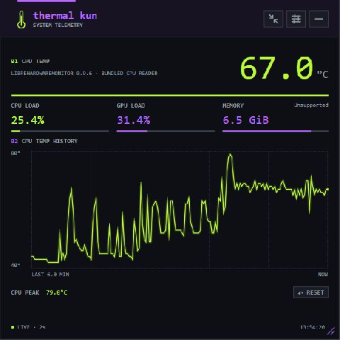

# thermal kun for Windows 0.1.3

Native WPF desktop panel for CPU temperature, CPU/GPU load, physical memory usage, temperature history and peak. The Windows panel and sensor list omit THERMAL STATUS. Temperature is not converted into a fabricated thermal-state or throttling indicator.



## Download and run

Download `thermal-kun-windows-0.1.3-temperature-preview-x64.zip` and its SHA-256 file from the [Windows distribution folder](https://drive.google.com/drive/folders/11HG4j0yWuMQaATIV9dsupPhOCHJHotiv). Extract the entire ZIP and run `ThermalKun/ThermalKun.exe`. The ZIP includes the .NET runtime. This is an unsigned Windows x64 preview.

The display runs with ordinary user privileges. CPU temperature uses bundled LibreHardwareMonitor 0.9.6 and PawnIO 2.2.0. In Settings, enable CPU temperature. Initial driver installation requires explicit confirmation; the CPU reader requires a Windows administrator confirmation each time the app starts. Cancelling leaves CPU/GPU load and memory available. No separate monitoring application or HTTP server is needed.

Compact/detail: Ctrl+C. Settings: Ctrl+comma. Hide: Escape. Show: tray double-click, tray Show, or run the same executable again. Quit: Settings or tray Quit. Dark/Light/System and 1/2/5/10-second sampling are supported. Startup registration is off by default.

[日本語の導入案内](docs/START-HERE.ja.md) · [Verification](docs/VERIFICATION.md) · [Dependencies](docs/DEPENDENCIES.md) · [Design](docs/DESIGN.md)

## Build on Windows

Install the .NET 10 SDK. From the repository root:

```powershell
# Downloads pinned dependencies into upstream/; does not install or execute them.
./Windows/scripts/prepare-dependencies.ps1
dotnet run --project Windows/tests/ThermalKun.Checks/ThermalKun.Checks.csproj -c Release
dotnet publish Windows/src/ThermalKun.App/ThermalKun.App.csproj -c Release -r win-x64 --self-contained true -o Windows/artifacts/win-x64 -m:1 -p:UseSharedCompilation=false
python Windows/scripts/package.py Windows/artifacts/win-x64
```

If local script execution is restricted, use the pinned URLs and hashes in DEPENDENCIES.md and place the verified files at the documented paths. Changing PowerShell or Windows security settings is unnecessary.

Only Windows x64 is verified for this version. Temperature accuracy against an external instrument, other PCs, ARM64, multiple monitors, sleep/resume, and public SmartScreen reputation remain unverified. macOS-style memory pressure remains Unsupported; physical memory use is a separate measured value.
